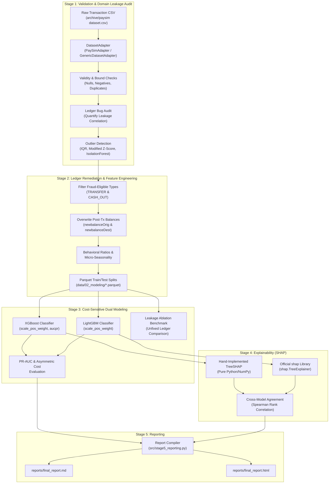

# Project Documentation: Architecture & Programming Reference

This document provides the complete technical reference for the **Transaction Anomaly Detection & Custom TreeSHAP Explainability** repository. It is organized into two chapters: a high-level architectural overview and a detailed module-by-module programming reference.

## Table of Contents

- [Chapter 1: High-Level System Overview & Architecture](#chapter-1-high-level-system-overview--architecture)
  - [1.1 Purpose & Problem Statement](#11-purpose--problem-statement)
  - [1.2 System Architecture & Data Flow](#12-system-architecture--data-flow)
  - [1.3 Design Principles](#13-design-principles)
  - [1.4 Pipeline Stage Summary](#14-pipeline-stage-summary)
  - [1.5 Technology Stack](#15-technology-stack)
- [Chapter 2: Detailed Programming & Implementation Reference](#chapter-2-detailed-programming--implementation-reference)
  - [2.1 Configuration & Dataset Adapter (`src/dataset_adapter.py`)](#21-configuration--dataset-adapter-srcdataset_adapterpy)
  - [2.2 Stage 1: Validity, Leakage Audit & Outliers (`src/stage1_audit_outliers.py`)](#22-stage-1-validity-leakage-audit--outliers-srcstage1_audit_outlierspy)
  - [2.3 Stage 2: Ledger Remediation & Feature Engineering (`src/stage2_remediate_features.py`)](#23-stage-2-ledger-remediation--feature-engineering-srcstage2_remediate_featurespy)
  - [2.4 Stage 3: Cost-Sensitive Training & Ablation (`src/stage3_training.py`)](#24-stage-3-cost-sensitive-training--ablation-srcstage3_trainingpy)
  - [2.5 Stage 4A: Hand-Implemented TreeSHAP (`src/stage4_shap_custom.py`)](#25-stage-4a-hand-implemented-treeshap-srcstage4_shap_custompy)
  - [2.6 Stage 4B: Library SHAP & Cross-Model Comparison (`src/stage4_shap_library.py`)](#26-stage-4b-library-shap--cross-model-comparison-srcstage4_shap_librarypy)
  - [2.7 Stage 5: Automated Report Compiler (`src/stage5_reporting.py`)](#27-stage-5-automated-report-compiler-srcstage5_reportingpy)
  - [2.8 CLI Orchestrator (`run_pipeline.py`)](#28-cli-orchestrator-run_pipelinepy)
  - [2.9 Automated Test Suite (`tests/test_pipeline.py`)](#29-automated-test-suite-teststest_pipelinepy)
  - [2.10 Extending the System to New Datasets](#210-extending-the-system-to-new-datasets)

---

# Chapter 1: High-Level System Overview & Architecture

## 1.1 Purpose & Problem Statement
Financial fraud detection pipelines must handle extreme class imbalance (~0.13% positive class in PaySim) and avoid misleading validation scores caused by synthetic data artifacts. In the PaySim mobile money dataset, the simulator frequently omits updating `newbalanceDest` during fraudulent transactions (**The Ledger Bug**). A standard decision tree trained on raw balances learns to detect this bookkeeping bug rather than genuine fraudulent behavior.

This system provides an end-to-end, reproducible pipeline that:
1. Audits data validity, statistical outliers, and simulation leakage before modeling.
2. Programmatically repairs double-entry bookkeeping balances to eliminate target leakage.
3. Trains two gradient-boosted tree classifiers (**XGBoost** and **LightGBM**) optimized for **PR-AUC** and asymmetric financial cost.
4. Explains flagged fraudulent transactions using a **from-scratch TreeSHAP implementation** for XGBoost and the official `shap` library for LightGBM.
5. Compiles all diagnostics, metrics, and case studies into standalone Markdown and HTML reports.

## 1.2 System Architecture & Data Flow

## 1.3 Design Principles

1. **Decoupled Stages via File Contracts:** Each stage reads inputs from disk (`data/`, `models/`) and writes standardized Parquet or JSON outputs. Any stage can be re-run independently via `run_pipeline.py --stage <N>`.
2. **Dataset Independence (Adapter Pattern):** Dataset-specific loading, schema mapping, and domain rules live exclusively in `src/dataset_adapter.py` and `configs/*.yaml`. Downstream training, SHAP, and reporting modules operate purely on numeric feature matrices and metadata JSON.
3. **Imbalance-Aware Evaluation:** Accuracy and ROC-AUC are insufficient under severe class imbalance. Primary model evaluation uses **PR-AUC (Average Precision)** and an asymmetric financial risk cost function (`Cost = FN * 500 + FP * 10`).
4. **First-Principles Explainability Verification:** The hand-implemented TreeSHAP explainer is mathematically verified against the Shapley Local Accuracy (Efficiency) Axiom ($\phi_0 + \sum_{i=1}^M \phi_i(x) = f(x)$) to floating-point machine epsilon.

## 1.4 Pipeline Stage Summary

| Stage | Module | Inputs | Outputs | Responsibility |
| :--- | :--- | :--- | :--- | :--- |
| **1** | `src/stage1_audit_outliers.py` | Raw CSV, YAML config | `data/01_audit/audit_summary.json`, `stage1_*.png` | Schema validity, type breakdown, `isFlaggedFraud` audit, Ledger Bug correlation, IQR/MAD/IsolationForest outliers. |
| **2** | `src/stage2_remediate_features.py` | Raw CSV via adapter | `data/02_modeling/*.parquet`, `feature_metadata.json` | Type filtering, balance overwrite, behavioral/temporal features, stratified 75/25 train/test split (clean & leaked). |
| **3** | `src/stage3_training.py` | Stage 2 Parquet splits | `models/xgboost_model.json`, `secondary_model.joblib`, `evaluation_metrics.json`, `stage3_*.png` | Trains XGBoost & LightGBM, computes PR-AUC & cost-optimal thresholds, runs leaked-ledger ablation. |
| **4A** | `src/stage4_shap_custom.py` | `xgboost_model.json`, `X_test.parquet` | `models/custom_xgboost_shap.json`, `stage4_custom_*.png` | Parses JSON trees, computes exact coalitional TreeSHAP, verifies efficiency axiom, explains fraud cases. |
| **4B** | `src/stage4_shap_library.py` | `secondary_model.joblib`, Stage 4A indices | `models/library_secondary_shap.json`, `stage4_library_*.png` | Runs `shap.TreeExplainer` on LightGBM and computes Spearman/Pearson agreement with Stage 4A. |
| **5** | `src/stage5_reporting.py` | Stages 1–4 JSON & PNGs | `reports/final_report.md`, `reports/final_report.html` | Compiles Markdown and self-contained Base64-embedded HTML reports. |

## 1.5 Technology Stack

- **Language:** Python 3.12+
- **Data Processing:** `pandas >= 2.2.0`, `numpy >= 2.0.0`, `pyarrow >= 15.0.0`
- **Modeling:** `xgboost >= 2.1.0`, `lightgbm >= 4.5.0`, `scikit-learn >= 1.5.0`
- **Explainability:** Pure Python/NumPy (custom TreeSHAP), `shap >= 0.46.0` (library comparison)
- **Statistics & Plotting:** `scipy >= 1.13.0`, `matplotlib >= 3.9.0` (`Agg` backend)
- **Configuration & Serialization:** `PyYAML >= 6.0.0`, `joblib >= 1.4.0`
- **Testing:** `pytest >= 9.2.0`

---

# Chapter 2: Detailed Programming & Implementation Reference

## 2.1 Configuration & Dataset Adapter (`src/dataset_adapter.py`)

### Configuration Loader (`load_config`)
`load_config(config_path)` loads a YAML file (default `configs/paysim_config.yaml`) and ensures all directories under `paths` (`audit_dir`, `modeling_dir`, `models_dir`, `reports_dir`, `figures_dir`) exist.

### Abstract Contract (`BaseDatasetAdapter`)
All dataset adapters inherit from `BaseDatasetAdapter(ABC)` and implement:
- `load_raw_data() -> pd.DataFrame`
- `compute_domain_audit_metrics(df: pd.DataFrame) -> Dict[str, Any]`
- `prepare_modeling_dataframe(df: pd.DataFrame, fix_leakage: bool = True) -> Tuple[pd.DataFrame, pd.Series, Dict[str, str]]`

### `PaySimAdapter`
- **`load_raw_data()`:** Reads `archive/paysim dataset.csv` (~6.36M rows) with explicit memory-optimized dtypes (`int32` for `step`, `category` for `type`, `float64` for currency fields, `int8` for binary flags).
- **`compute_domain_audit_metrics(df)`:** Computes per-type fraud counts, evaluates `isFlaggedFraud` recall (16 / 8,213 = 0.1948%), checks `C`/`M` entity prefixes, and measures Ledger Bug prevalence (49.56% destination balance freeze in fraud vs. 0.06% in legitimate transactions; 97.63% exact 100% balance depletion in fraud).
- **`filter_and_subsample(df)`:** Retains `TRANSFER` and `CASH_OUT` rows, preserves 100% of `isFraud == 1` rows (8,213), and samples `sample_negative_count` (300,000) legitimate rows when configured.
- **`prepare_modeling_dataframe(df, fix_leakage=True)`:** Recalculates post-transaction balances when `fix_leakage=True` and engineers the 12 modeling features. When `fix_leakage=False`, retains raw balances and adds `raw_error_orig` and `raw_error_dest` for the Stage 3 ablation study.

### `GenericDatasetAdapter` & Factory (`get_dataset_adapter`)
`GenericDatasetAdapter` provides a zero-code fallback for arbitrary tabular CSVs defined via `configs/template_config.yaml`. `get_dataset_adapter(config)` selects `PaySimAdapter` when `adapter_type == "paysim"` and `GenericDatasetAdapter` otherwise.

---

## 2.2 Stage 1: Validity, Leakage Audit & Outliers (`src/stage1_audit_outliers.py`)

- **`compute_validity_checks(df, numeric_cols)`:** Counts nulls per column, negative values and `np.isinf` entries across numeric columns, and exact duplicate rows (`df.duplicated().sum()`). Returns `is_valid_schema: True` only if nulls, negatives, and infinities are all zero.
- **`compute_outlier_analysis(df, seed=42)`:** Operates on `TRANSFER` and `CASH_OUT` rows:
  - *Univariate:* Computes Q25, Median, Q75, Q99, IQR upper fence (`Q75 + 1.5 * IQR`), extreme fence (`Q75 + 3.0 * IQR`), and Modified Z-Score (`|x - median| / (1.4826 * MAD) > 3.5`) for `amount`, `oldbalanceOrg`, and `oldbalanceDest`. Records what percentage of true fraud falls inside the IQR outlier region (e.g., 82.22% for `oldbalanceOrg`).
  - *Multivariate:* Fits `IsolationForest(n_estimators=100, contamination=0.05)` on $\log(1 + \max(0, x))$ over all 8,213 fraud rows + 100,000 legitimate rows.
- **`generate_stage1_plots(...)`:** Saves `reports/figures/stage1_leakage_and_types.png` and `reports/figures/stage1_outliers_and_seasonality.png`.
- **Entrypoint:** `run_stage1(config_path)` writes `data/01_audit/audit_summary.json`.

---

## 2.3 Stage 2: Ledger Remediation & Feature Engineering (`src/stage2_remediate_features.py`)

1. Calls `adapter.filter_and_subsample(raw_df)` -> 308,213 rows (8,213 fraud, 2.665% positive rate).
2. Calls `adapter.prepare_modeling_dataframe(filtered_df, fix_leakage=True)` to overwrite:
   $$\text{newbalanceOrig}_{\text{fixed}} = \max(0.0, \text{oldbalanceOrg} - \text{amount})$$
   $$\text{newbalanceDest}_{\text{fixed}} = \text{oldbalanceDest} + \text{amount}$$
3. Engineers 12 clean numeric features: `amount`, `oldbalanceOrg`, `newbalanceOrig`, `oldbalanceDest`, `newbalanceDest`, `account_depletion_ratio` ($\min(5.0, \text{amount} / \text{oldbalanceOrg})$), `dest_surge_ratio` ($\text{amount} / (\text{oldbalanceDest} + \text{amount} + 1.0)$), `is_zero_oldbalance_orig`, `is_zero_oldbalance_dest`, `hour_of_day` ($\text{step} \bmod 24$), `day_of_week` ($\lfloor \text{step} / 24 \rfloor \bmod 7$), and `is_transfer`.
4. Also generates `X_train_leaked.parquet` and `X_test_leaked.parquet` (`fix_leakage=False`) using identical stratified 75/25 split indices for Stage 3 ablation.
5. Writes `data/02_modeling/feature_metadata.json` and Parquet files.

---

## 2.4 Stage 3: Cost-Sensitive Training & Ablation (`src/stage3_training.py`)

- **Imbalance Handling:** Computes `scale_pos_weight = n_neg / n_pos` (`36.526` on the training split).
- **Models Trained:**
  1. `xgb.XGBClassifier` (`n_estimators=250`, `max_depth=6`, `learning_rate=0.08`, `eval_metric="aucpr"`), saved to `models/xgboost_model.json`.
  2. `lgb.LGBMClassifier` (`n_estimators=250`, `max_depth=6`, `num_leaves=31`, `learning_rate=0.08`), or `RandomForestClassifier` if configured, saved to `models/secondary_model.joblib`.
- **`evaluate_predictions(y_true, y_prob, cost_fn, cost_fp)`:** Computes PR-AUC (`average_precision_score`), ROC-AUC, and confusion matrices at three thresholds: `0.5`, maximum F1 on the PR curve, and minimum asymmetric cost across a 199-point threshold grid (`0.01` to `0.99`).
- **Leakage Ablation:** Trains an identical `XGBClassifier` on `X_train_leaked.parquet` and compares gain importances (`raw_error_orig` captures 51.15% of gain when unfixed vs. `oldbalanceOrg` 38.82% and `account_depletion_ratio` 34.28% after remediation).
- **Outputs:** `models/evaluation_metrics.json`, `models/test_predictions.parquet`, `stage3_pr_curves_and_cost.png`, and `stage3_leakage_ablation_importance.png`.

---

## 2.5 Stage 4A: Hand-Implemented TreeSHAP (`src/stage4_shap_custom.py`)

`CustomXGBoostTreeSHAPExplainer` computes exact path-dependent TreeSHAP values for `XGBClassifier` without calling `shap` or `pred_contribs`:

1. **Tree Parsing (`ParsedXGBTree` & `TreeNode`):** Extracts all 250 trees via `booster.get_dump(dump_format="json", with_stats=True)`. Preserves `booster.feature_names` ordering if present. Precomputes cover-weighted child probabilities:
   $$w_{\text{yes}} = \frac{R_{\text{yes}}}{R_{\text{yes}} + R_{\text{no}}}, \quad w_{\text{no}} = \frac{R_{\text{no}}}{R_{\text{yes}} + R_{\text{no}}}$$
2. **Active-Feature Coalitional Reduction:** Each tree $t$ (depth $\le 6$) splits on a subset $U_t$ of at most $k \le 10$ unique features. Features outside $U_t$ have zero marginal contribution ($\phi_j^{(t)} = 0$), so exact Shapley values for $i \in U_t$ depend only on the $2^k$ coalitions $S \subseteq U_t$:
   $$\phi_i^{(t)}(x) = \sum_{S \subseteq U_t \setminus \{i\}} \frac{|S|!(k - |S| - 1)!}{k!} \left[ f_x^{(t)}(S \cup \{i\}) - f_x^{(t)}(S) \right]$$
3. **Vectorized Bitmask Evaluation (`_build_coalition_tables`, `_explain_single_tree`):** Precomputes bitmask coalition tables and factorial weights per active feature count $k$. Evaluates conditional expectations $V[\text{node}, S]$ bottom-up in post-order traversal using vectorized `np.where` over all $2^k$ masks simultaneously.
4. **Base Margin Calibration:** Computes `base_margin_offset` by comparing `booster.predict(..., output_margin=True)` against the raw leaf sum on a zero vector, ensuring `expected_value` ($\phi_0 = 0.93812$) and predicted margins match XGBoost's exact log-odds output.
5. **Verification:** Across 300 stratified test instances, `max |phi_0 + sum(phi_i) - f(x)| = 1.954e-14`. Saves `models/custom_xgboost_shap.json` and `stage4_custom_*.png`.

---

## 2.6 Stage 4B: Library SHAP & Cross-Model Comparison (`src/stage4_shap_library.py`)

- Loads `models/secondary_model.joblib` and the exact `global_sample_indices` and `selected_case_study_indices` from `models/custom_xgboost_shap.json`.
- Runs `shap.TreeExplainer(sec_model)` and normalizes positive-class log-odds outputs via `extract_positive_class_shap()`.
- Computes Spearman rank correlation (`0.7063`) and Pearson correlation (`0.7782`) between global mean $|\phi_i|$ of custom XGBoost SHAP and library LightGBM SHAP.
- Saves `models/library_secondary_shap.json` and `stage4_library_shap_and_comparison.png`.

---

## 2.7 Stage 5: Automated Report Compiler (`src/stage5_reporting.py`)

- Reads all JSON outputs from Stages 1–4 (`audit_summary.json`, `feature_metadata.json`, `evaluation_metrics.json`, `custom_xgboost_shap.json`, `library_secondary_shap.json`).
- Generates `reports/final_report.md` with Markdown tables, ablation findings, mathematical verification stats, and transaction case studies.
- Generates `reports/final_report.html` by embedding all 7 PNG figures from `reports/figures/` as inline Base64 data URIs (`encode_image_b64()`), making the HTML report completely portable.

---

## 2.8 CLI Orchestrator (`run_pipeline.py`)

Parses `--config` (path to YAML config, default `configs/paysim_config.yaml`) and `--stage` (`all`, `1`, `2`, `3`, `4`, `4a`, `4b`, `5`) and invokes the corresponding `run_stage*` functions sequentially.

---

## 2.9 Automated Test Suite (`tests/test_pipeline.py`)

Contains 7 `pytest` tests verifying every stage contract:
- `test_config_loader`: Validates YAML structure and required keys.
- `test_dataset_adapter_interface`: Verifies adapter contract methods and `target_col`.
- `test_stage1_audit_output`: Checks `audit_summary.json` schema validity and Ledger Bug metrics.
- `test_stage2_data_splits`: Verifies Parquet shapes, 12 feature columns, and absence of NaNs/infinities.
- `test_stage3_model_evaluations`: Asserts both models exceed `0.95` PR-AUC.
- `test_stage4_custom_treeshap_efficiency`: Checks saved verification error `< 1e-10` and runs a live `CustomXGBoostTreeSHAPExplainer` check on a synthetic vector.
- `test_stage5_reports_exist`: Confirms non-empty `final_report.md` and `final_report.html`.

---

## 2.10 Extending the System to New Datasets

1. Create `configs/<dataset_name>.yaml` based on `configs/template_config.yaml`.
2. For standard tabular CSVs without custom accounting rules, set `adapter_type: "generic"` to use `GenericDatasetAdapter`.
3. For datasets with domain-specific preprocessing or leakage rules, subclass `BaseDatasetAdapter` in `src/dataset_adapter.py`, implement the three abstract methods, and register the `adapter_type` string in `get_dataset_adapter()`.
4. Run `python run_pipeline.py --config configs/<dataset_name>.yaml --stage all`.
