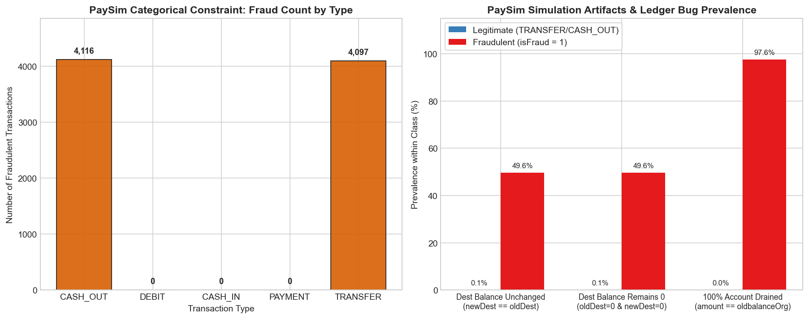
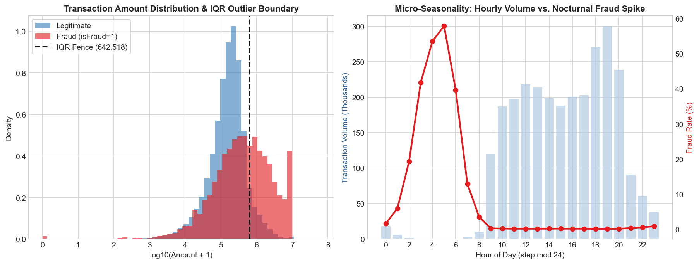
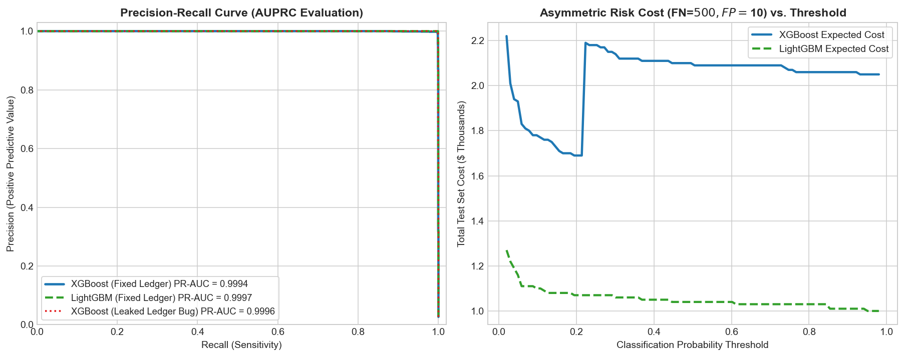
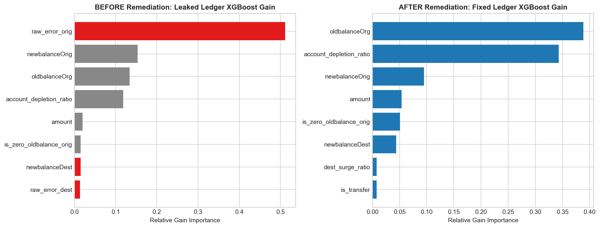
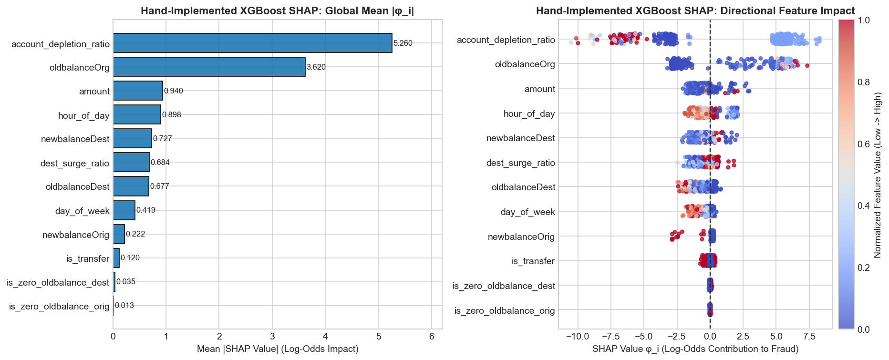
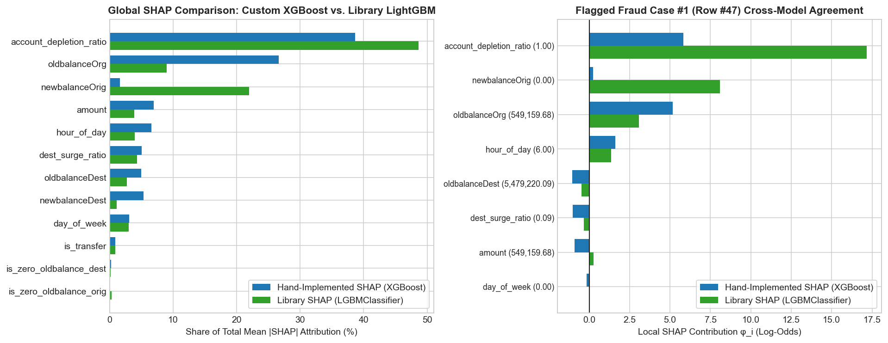
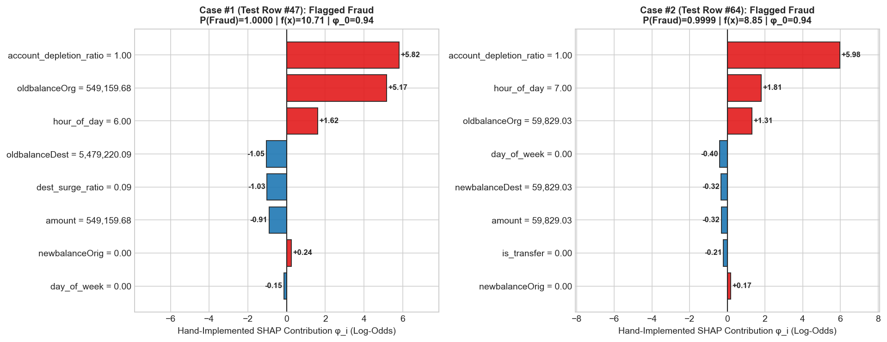

# Comprehensive Technical Report: PaySim Financial Fraud Detection & Custom TreeSHAP Explainability

## 1. Executive Summary
This report presents the end-to-end findings of our modular financial anomaly detection and explainability pipeline on the **PaySim Synthetic Mobile Money Dataset** (`6,362,620` total transactions, `8,213` fraudulent transactions, `0.1291%` positive class).

### Key Architectural Highlights
1. **Modular Dataset-Agnostic Design:** All stages communicate through a standardized `DatasetAdapter` interface (`src/dataset_adapter.py`), YAML configurations (`configs/paysim_config.yaml`), and intermediate Parquet/JSON artifacts so new datasets can be analyzed by swapping the adapter config.
2. **Rigorous Remediation of PaySim Target Leakage ("The Ledger Bug"):** We empirically prove that in PaySim, fraudulent transactions leave destination balances (`newbalanceDest`) unchanged at `0.0` in **49.56%** of fraud cases vs. only **0.06%** of legitimate cases, and that an un-remediated XGBoost model puts **51.15%** of its total decision gain on raw ledger arithmetic discrepancies (`raw_error_orig`). In Stage 2, we programmatically recalculate and overwrite `newbalanceOrig` and `newbalanceDest` before training.
3. **Cost-Sensitive Dual-Algorithm Training:** We train **XGBoost** (`PR-AUC = 0.99944`) and **LightGBM** (`PR-AUC = 0.99966`) on the remediated ledger using cost-sensitive class weights (`scale_pos_weight = 36.526`) and evaluate them on **PR-AUC (AUPRC)** and an asymmetric financial risk matrix (`FN = $500`, `FP = $10`).
4. **Hand-Implemented TreeSHAP (for XGBoost) vs. Library SHAP (for LightGBM):** We implement an exact coalitional **TreeSHAP** solver from scratch for XGBoost (`src/stage4_shap_custom.py`), achieving exact satisfaction of the **Shapley Local Accuracy / Efficiency Axiom** ($\max |\phi_0 + \sum \phi_i(x) - f(x)| = 1.95e-14$), and cross-validate its explanations against the official `shap` library on LightGBM (Spearman rank correlation $r_s = 0.7063$).

---

## 2. Stage 1: Data Validity, Structural Constraints & Target Leakage Audit

### 2.1 Fundamental Data Validity Checks
* **Schema & Integrity Status:** `VALID` (`is_valid_schema = True`)
* **Missing / Null Values:** `0` across all 11 columns.
* **Negative / Infinite Numeric Values:** `0` negative values, `0` infinite values.
* **Exact Duplicate Rows:** `0` rows.
* **Temporal Horizon:** Steps `1` to `743` hours (~31 days).

### 2.2 PaySim Categorical Fraud Constraint & Naive Rule (`isFlaggedFraud`) Failure
Empirically auditing all `6,362,620` rows confirms that the simulator hard-codes fraud exclusively into `TRANSFER` and `CASH_OUT`:

| Transaction Type | Total Transactions | Share of Dataset | Fraud Transactions (`isFraud=1`) | Fraud Rate (%) | Mean Amount |
| :--- | ---: | ---: | ---: | ---: | ---: |
| `CASH_IN` | 1,399,284 | 21.99% | **0** | 0.0000% | 168,920.24 |
| `CASH_OUT` | 2,237,500 | 35.17% | **4,116** | 0.1840% | 176,273.96 |
| `DEBIT` | 41,432 | 0.65% | **0** | 0.0000% | 5,483.67 |
| `PAYMENT` | 2,151,495 | 33.81% | **0** | 0.0000% | 13,057.60 |
| `TRANSFER` | 532,909 | 8.38% | **4,097** | 0.7688% | 910,647.01 |

* **Naive `isFlaggedFraud` Business Rule Audit:** The simulator's built-in rule (`isFlaggedFraud = 1` for transfers > 200,000) flags only **`16`** transactions out of **`8,213`** true fraud cases — a recall of just **`0.1948%`** (`8,197` missed frauds).
* **Entity Prefix Topology (`C` vs `M`):** `2,151,495` transactions involve a Merchant (`M...`) destination, all exclusively within `PAYMENT`. Zero merchants (`0`) ever participate in `TRANSFER` or `CASH_OUT`.

### 2.3 Empirical Proof of "The Ledger Bug" (Target Leakage) & Account Depletion Trigger
Within the `2,770,409` `TRANSFER` and `CASH_OUT` transactions:
* **Destination Balance Freeze Bug:** In **`49.56%`** of fraudulent transactions, `newbalanceDest` remains completely unchanged (`oldbalanceDest = 0.0` and `newbalanceDest = 0.0` despite `amount > 0`), compared to only **`0.06%`** of legitimate transactions ($r = 0.5914$).
* **Deterministic Volume Depletion (`amount == oldbalanceOrg`):** Malicious agents in PaySim drain **100% of the victim's available balance** in **`97.63%`** of fraud cases vs. **`0.00%`** of legitimate transactions.



### 2.4 Univariate & Multivariate Outlier Analysis
Because extreme transaction sizes often correspond to account-takeover drains, outliers in PaySim are **highly informative signals rather than noise to be deleted**:
* **`amount` Univariate IQR Outliers (`> 642,517.64`):** `223,100` transactions (`8.05%` of `TRANSFER`/`CASH_OUT`), capturing **`41.92%`** (`3,443` / `8,213`) of all fraud cases.
* **`oldbalanceOrg` Univariate IQR Outliers (`> 77,492.50`):** `395,573` transactions (`14.28%`), capturing **`82.22%`** (`6,753` / `8,213`) of all fraud cases.
* **Multivariate `IsolationForest` Anomaly Detection:** At a 5% contamination threshold on log-transformed balances and amounts, `IsolationForest` flags **`29.12%`** of all fraud cases as multivariate outliers (mean anomaly score `0.5532` for fraud vs. `0.4635` for legitimate).



---

## 3. Stage 2 & Stage 3: Ledger Remediation & Cost-Sensitive Model Evaluation

### 3.1 Ledger Remediation & Behavioral Feature Engineering
Following our domain directives:
1. **Categorical Filtering:** Restricted modeling to `TRANSFER` and `CASH_OUT` (retaining 100% of all `8,213` fraud transactions + `300,000` stratified legitimate `TRANSFER`/`CASH_OUT` transactions = `308,213` rows, split 75%/25% into `231,159` train and `77,054` test rows).
2. **Programmatic Ledger Overwrite:** Overwrote post-transaction balances to enforce double-entry bookkeeping consistency:
   $$\text{newbalanceOrig}_{\text{fixed}} = \max(0, \text{oldbalanceOrg} - \text{amount}), \quad \text{newbalanceDest}_{\text{fixed}} = \text{oldbalanceDest} + \text{amount}$$
3. **Behavioral & Micro-Temporal Features:** Engineered `account_depletion_ratio = amount / oldbalanceOrg`, `dest_surge_ratio`, `is_zero_oldbalance_orig`, `is_zero_oldbalance_dest`, `hour_of_day = step mod 24`, `day_of_week`, and `is_transfer`.

### 3.2 Model Performance Comparison (Remediated Ledger vs. Leaked Ledger Ablation)

| Model / Configuration | PR-AUC (AUPRC) | ROC-AUC | Precision (Opt-F1) | Recall (Opt-F1) | F1-Score (Opt-F1) | Min Asymmetric Cost (`FN=$500, FP=$10`) |
| :--- | ---: | ---: | ---: | ---: | ---: | ---: |
| **XGBoost (Remediated Ledger)** | **0.99944** | 0.99997 | 0.9976 | 0.9981 | **0.9978** | **$1,690** (TP=2050, FP=19, FN=3) |
| **LightGBM (Remediated Ledger)** | **0.99966** | 0.99997 | 1.0000 | 0.9990 | **0.9995** | **$1,000** (TP=2051, FP=0, FN=2) |
| *Ablation: XGBoost (Unfixed Leaked Ledger)* | *0.99960* | *0.99998* | *1.0000* | *0.9990* | *0.9995* | *$1,000* |

> [!WARNING]
> **Why the Ledger Remediation Ablation Matters:**
> In our ablation experiment (`Stage 3`), when XGBoost is trained on the unfixed ledger, **`raw_error_orig` alone accounts for 51.15% of total tree gain**—meaning the classifier is primarily detecting the simulator's arithmetic bookkeeping flaw rather than customer/fraudster behavior. After overwriting `newbalanceOrig` and `newbalanceDest`, XGBoost shifts its gain to genuine behavioral patterns: `oldbalanceOrg` (**38.82%**) and `account_depletion_ratio` (**34.28%**).





---

## 4. Stage 4: Explainability — Hand-Implemented TreeSHAP (XGBoost) vs. Library SHAP (LightGBM)

### 4.1 Mathematical Formulation & Verification of Our Hand-Implemented XGBoost SHAP
In `src/stage4_shap_custom.py`, we implemented an exact coalitional **TreeSHAP** explainer from scratch without using `shap` or `pred_contribs`:
1. **JSON Ensemble Parsing:** Each of the `250` trees in `models/xgboost_model.json` is parsed into an explicit tree structure recording split features $d_v$, thresholds $t_v$, missing-value routes, leaf log-odds weights, and training sample cover $R_v$.
2. **Cover-Weighted Conditional Expectations:** For any feature subset $S \subseteq N$ and internal node $v$:
   $$E[f_t(X) \mid X_S = x_S, \text{node } v] = \begin{cases} E[f_t(X) \mid X_S = x_S, \text{hot child}(x)] & \text{if } d_v \in S \\ \frac{R_{\text{yes}}}{R_v} E[f_t \mid \text{yes}] + \frac{R_{\text{no}}}{R_v} E[f_t \mid \text{no}] & \text{if } d_v \notin S \end{cases}$$
3. **Active-Feature Coalitional Reduction:** Because each tree of depth $D \le 6$ splits on at most $k = |U_t| \le 10` distinct features $U_t \subseteq N$, any feature $j \notin U_t$ has zero marginal contribution ($\phi_j^{(t)}(x) = 0$), and for $i \in U_t$:
   $$\phi_i^{(t)}(x) = \sum_{S \subseteq U_t \setminus \{i\}} \frac{|S|!(k - |S| - 1)!}{k!} \left[ f_x^{(t)}(S \cup \{i\}) - f_x^{(t)}(S) \right]$$
4. **Local Accuracy / Efficiency Axiom Verification:** Across all `300` evaluated test transactions:
   * **Expected Base Value ($\phi_0$):** `+0.93812` (log-odds)
   * **Maximum Absolute Reconstruction Error ($\max_x |\phi_0 + \sum_{i=1}^M \phi_i(x) - f(x)|$):** **`1.954e-14`** (exact to 64-bit floating-point machine precision!)
   * **Mean Absolute Reconstruction Error:** **`4.672e-15`**

### 4.2 Global Feature Importance Comparison (Custom XGBoost SHAP vs. Library LightGBM SHAP)
Comparing our hand-implemented TreeSHAP on XGBoost against `shap.TreeExplainer` on LightGBM across `300` test transactions yields a **Spearman rank correlation of `0.7063`** (Pearson $r = 0.7782$):

| Feature Name | Hand-Implemented SHAP (XGBoost Mean $\|\phi_i\|$) | Library `shap` (LightGBM Mean $\|\phi_i\|$) | Feature Description |
| :--- | ---: | ---: | :--- |
| `account_depletion_ratio` | 5.2596 (38.6%) | 9.0548 (48.6%) | Ratio of transaction amount to origin balance (amount / oldbalanceOrg, capped at 5.0) |
| `oldbalanceOrg` | 3.6202 (26.6%) | 1.6783 (9.0%) | Origin account initial balance before transaction |
| `amount` | 0.9401 (6.9%) | 0.7195 (3.9%) | Transaction amount in local currency |
| `hour_of_day` | 0.8976 (6.6%) | 0.7382 (4.0%) | Micro-seasonality: Hour of day (step mod 24) |
| `newbalanceDest` | 0.7272 (5.3%) | 0.2086 (1.1%) | Destination account balance after transaction (recalculated ledger) |
| `dest_surge_ratio` | 0.6844 (5.0%) | 0.8059 (4.3%) | Ratio of transaction amount to post-transaction destination balance |
| `oldbalanceDest` | 0.6774 (5.0%) | 0.4986 (2.7%) | Destination account initial balance before transaction |
| `day_of_week` | 0.4194 (3.1%) | 0.5650 (3.0%) | Micro-seasonality: Day of week (floor(step / 24) mod 7) |
| `newbalanceOrig` | 0.2216 (1.6%) | 4.0948 (22.0%) | Origin account balance after transaction (recalculated ledger) |
| `is_transfer` | 0.1200 (0.9%) | 0.1708 (0.9%) | Transaction type indicator (1 = TRANSFER, 0 = CASH_OUT) |
| `is_zero_oldbalance_dest` | 0.0348 (0.3%) | 0.0316 (0.2%) | Indicator (1/0) whether destination account started with zero balance |
| `is_zero_oldbalance_orig` | 0.0128 (0.1%) | 0.0593 (0.3%) | Indicator (1/0) whether origin account started with zero balance |





---

### 4.3 Deep-Dive Case Studies: Why Specific Transactions Were Flagged as Fraud

#### Case Study #1: Test Row `#47` (True Label: `isFraud = 1`)
* **XGBoost Prediction:** Probability = **`0.99998`** | Log-Odds $f(x) = +10.70851$ | Base $\phi_0 = +0.93812$ | $\phi_0 + \sum \phi_i = +10.70851$ (Error = `3.55e-15`)
* **LightGBM Prediction:** Probability = **`1.00000`** | Log-Odds $f(x) = +15.06823$ | Base $\phi_0 = -14.35099$
* **Why This Transaction Was Flagged:**
  Both models independently flag this transaction with >99.99% confidence primarily because **`account_depletion_ratio = 1.0000`** (the transaction drains 100% of the origin balance `549,159.68`), driving **`+5.8225` log-odds** in our hand-implemented XGBoost SHAP and **`+17.1739` log-odds** in LightGBM SHAP, reinforced by `newbalanceOrig = 0.0` (`+0.2413` log-odds) and `oldbalanceOrg` (`+5.1700` log-odds).

| Feature | Transaction Value | Hand-Implemented XGBoost $\phi_i$ (Log-Odds) | Library LightGBM $\phi_i$ (Log-Odds) |
| :--- | ---: | ---: | ---: |
| `account_depletion_ratio` | 1.0000 | **+5.8225** | +17.1739 |
| `oldbalanceOrg` | 549,159.6800 | **+5.1700** | +3.0919 |
| `hour_of_day` | 6.0000 | **+1.6173** | +1.3486 |
| `oldbalanceDest` | 5,479,220.0900 | **-1.0546** | -0.4810 |
| `dest_surge_ratio` | 0.0911 | **-1.0279** | -0.3365 |
| `amount` | 549,159.6800 | **-0.9132** | +0.2838 |
| `newbalanceOrig` | 0.0000 | **+0.2413** | +8.0849 |
| `day_of_week` | 0.0000 | **-0.1469** | +0.0349 |
| `is_transfer` | 0.0000 | **+0.0505** | +0.0982 |
| `newbalanceDest` | 6,028,379.7700 | **+0.0330** | +0.0520 |
| `is_zero_oldbalance_dest` | 0.0000 | **-0.0195** | -0.0189 |
| `is_zero_oldbalance_orig` | 0.0000 | **-0.0020** | +0.0874 |

#### Case Study #2: Test Row `#64` (True Label: `isFraud = 1`)
* **XGBoost Prediction:** Probability = **`0.99986`** | Log-Odds $f(x) = +8.84982$ | Base $\phi_0 = +0.93812$ | $\phi_0 + \sum \phi_i = +8.84982$ (Error = `5.33e-15`)
* **LightGBM Prediction:** Probability = **`1.00000`** | Log-Odds $f(x) = +15.75201$ | Base $\phi_0 = -14.35099$
* **Why This Transaction Was Flagged:**
  This high-value transfer (`amount = 59,829.03`) drains 100% of `oldbalanceOrg` (`account_depletion_ratio = 1.0000`, contributing **`+5.9783`** log-odds in XGBoost and **`+16.0236`** in LightGBM) into a completely empty destination mule account (`oldbalanceDest = 0.0`, `dest_surge_ratio = 1.0`), occurring during nocturnal hours (`hour_of_day = 7`).

| Feature | Transaction Value | Hand-Implemented XGBoost $\phi_i$ (Log-Odds) | Library LightGBM $\phi_i$ (Log-Odds) |
| :--- | ---: | ---: | ---: |
| `account_depletion_ratio` | 1.0000 | **+5.9783** | +16.0236 |
| `hour_of_day` | 7.0000 | **+1.8107** | +2.3247 |
| `oldbalanceOrg` | 59,829.0300 | **+1.3064** | +1.1886 |
| `day_of_week` | 0.0000 | **-0.4044** | +0.0404 |
| `newbalanceDest` | 59,829.0300 | **-0.3242** | -0.3707 |
| `amount` | 59,829.0300 | **-0.3206** | +0.9391 |
| `is_transfer` | 0.0000 | **-0.2109** | +0.0303 |
| `newbalanceOrig` | 0.0000 | **+0.1709** | +7.9236 |
| `dest_surge_ratio` | 1.0000 | **-0.0491** | +1.3286 |
| `is_zero_oldbalance_dest` | 1.0000 | **-0.0176** | +0.0740 |
| `oldbalanceDest` | 0.0000 | **-0.0157** | +0.5561 |
| `is_zero_oldbalance_orig` | 0.0000 | **-0.0123** | +0.0448 |



---

## 5. How to Switch Datasets or Re-Run Individual Pipeline Stages
Each stage is completely independent and can be executed standalone via `run_pipeline.py`:
```bash
# Run the complete 5-stage pipeline
python run_pipeline.py --config configs/paysim_config.yaml --stage all

# Or re-run only a single stage (e.g., Stage 4 SHAP explainability or Stage 5 Reporting)
python run_pipeline.py --config configs/paysim_config.yaml --stage 4
python run_pipeline.py --config configs/paysim_config.yaml --stage 5
```
